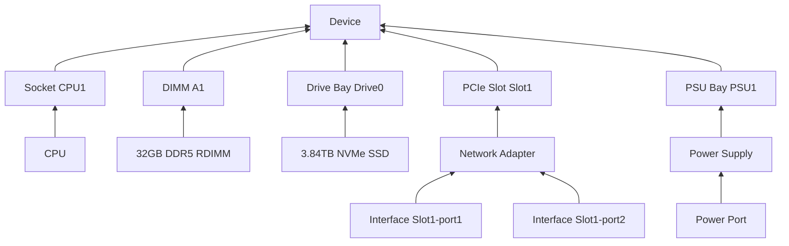
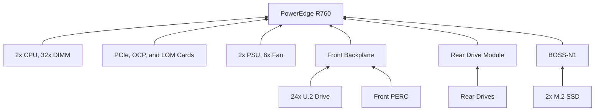
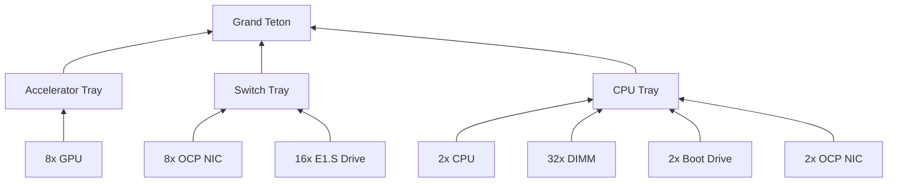

# Modeling Servers

## Use Case

A physical server is a chassis that holds field-replaceable components: processors, memory modules, drives, expansion cards, and power supplies. Two servers of the same model often ship with very different configurations, and their components get replaced, upgraded, and moved between servers over the life of the hardware.

These components were historically recorded as inventory items, which have been deprecated since NetBox v4.3. Existing inventory items continue to function, and NetBox does not convert them to modules automatically. Once a component has been recorded as a module, delete its inventory item so that it isn't recorded twice. This guide captures the recommended strategy for modeling servers and their components on NetBox v4.7 and later.

## Modeling Strategy

Each server is represented as a [device](../models/dcim/device.md), and each field-replaceable component is represented as a [module](../models/dcim/module.md) installed within a [module bay](../models/dcim/modulebay.md) on that device. A [module type profile](../models/dcim/moduletypeprofile.md) assigned to each [module type](../models/dcim/moduletype.md) records the attributes relevant to its kind of component, such as the size and class of a memory module or the capacity of a drive.

A module does not need to deliver any components to the device. A memory module or a CPU is a module with no interfaces or other components. A network adapter, by contrast, delivers its interfaces to the device when installed, and a power supply delivers its power port.



### Before You Start

List every slot and replaceable part in the chassis, using the vendor's technical documentation and the labels printed on the chassis. Then check the community [Device Type Library](https://github.com/netbox-community/devicetype-library): it publishes ready-made definitions for many device types and module types, including their module bays, which can be imported into NetBox rather than built by hand.

### Choosing What to Model

If a chassis holds complete servers, each with its own processors, memory, and operating system (such as a blade enclosure, or a multi-node chassis holding four servers in 2U), model each server as a child device installed in a [device bay](../models/dcim/devicebay.md) on the chassis, not as a module. Set the chassis device type's parent/child status to **Parent** and give it a device bay for each node. Set each node's device type to **Child**, with a height of 0U, and model it as described in this guide. Install a node from the chassis's **Device Bays** tab. Components shared by all the nodes, such as power supplies and fans, belong to the chassis.

Model the components you replace, upgrade, track by serial number, or need to find later. A part that is never serviced on its own, such as a fixed chassis fan, can be left out. Hardware built into the chassis, such as onboard network ports or the management controller's port, belongs on the device type as ordinary component templates rather than as modules.

A module's type can carry module bays of its own, so that other modules are installed within it rather than directly in a bay on the device. This is called nesting: a GPU installed in a bay on a GPU tray, which is in turn installed in a bay on the chassis, is a nested module. Nest modules only where an assembly that holds other components is itself replaced or tracked as a unit, such as a GPU tray. Nest only as deep as you track: if a tray simply carries a baseboard that holds the GPUs, and the tray is not tracked on its own, model the baseboard alone, installed directly in the chassis. A riser or cage that is never tracked on its own can be left out: model its slots as module bays on the device type. Conversely, when a chassis is sold with different drive backplanes, modeling the backplane as a module that holds the drive bays lets a single device type cover every configuration.

When a component physically blocks a neighboring bay, such as a double-wide GPU covering the adjacent PCIe slot, disable the blocked module bay (clear its **Enabled** setting) so that nothing can be installed in it. Disabling a bay does not remove a module already installed in it.

### 1. Select Module Type Profiles

NetBox includes default module type profiles for the most common server components:

| Profile        | Attributes                                                   |
|----------------|--------------------------------------------------------------|
| CPU            | Architecture, cores, speed (GHz)                             |
| Memory         | Class (DDR3, DDR4, DDR5), size (GB), data rate (MT/s), ECC   |
| Hard disk      | Type (HD, SSD, NVME), size (GB), speed (RPM)                 |
| GPU            | GPU, interface (PCIe generation and width), memory (GB)      |
| Expansion card | Connector type, bandwidth                                    |
| Power supply   | Current type (AC, DC), voltage, wattage, hot-swappable       |
| Fan            | RPM                                                          |

These profiles are created when NetBox's database is first set up, or when it is upgraded to v4.3. Profiles added in later releases are not created on existing installations: for example, an installation that reached v4.3 before v4.3.4 has no Expansion card profile. If any of these profiles are not present, or if you need a different set of attributes, create your own profiles instead. Attributes are defined by editing a profile's [JSON schema](https://json-schema.org/) (the [module type profile documentation](../models/dcim/moduletypeprofile.md) includes an example schema), and can be added or changed at a later point. A profile does not need a schema at all: for parts such as RAID controllers or host bus adapters, a profile with no schema can serve purely to classify module types. Assigning a profile to a module type is optional, but recommended: attribute values are validated against the profile's schema, and module types can be filtered by them. If a schema defines default values (the default Memory, Hard disk and Power supply profiles do), the module type form fills them in, so review them before saving.

### 2. Create Module Bay Types

Create a [module bay type](../models/dcim/modulebaytype.md) for each kind of slot found in your servers, such as `LGA4677 Socket`, `DDR5 DIMM Slot`, `U.2 Drive Bay`, `PCIe x16 Slot`, and `PSU Bay`. When both a module bay and a module type declare bay types, NetBox will permit a module to be installed in the bay only if they share at least one type. This prevents, for example, a memory module from being installed in a drive bay. Bay types exist only to restrict which module types fit where, so create as few as you need: a single `PCIe Slot` type may be enough, or you might split it by slot width if cards must be checked against their slots.

Assign bay types to module types and module bays before installing modules, so that compatibility is checked as each module is installed.

!!! note
    Module bay types are optional. Skip this step if you do not need NetBox to enforce compatibility.

### 3. Create a Module Type for Each Component Model

Next, create a module type to represent each unique component model in your servers (creating its manufacturer first, if needed). Each module type should define a manufacturer and a unique model name, assign the appropriate profile, and fill in the profile's attributes. Bulk import identifies module types by model alone, so avoid reusing a model name under two manufacturers. Whether you put the vendor's orderable part number in the model name or in the separate part number field, do it consistently. If you created bay types in the previous step, assign each module type the bay type(s) it fits. For example:

| Manufacturer | Model                | Profile        | Attributes                   | Bay Type        |
|--------------|----------------------|----------------|------------------------------|-----------------|
| Intel        | Xeon Gold 6430       | CPU            | x86_64, 32 cores, 2.1 GHz    | LGA4677 Socket  |
| Samsung      | M321R4GA3BB6-CQK     | Memory         | DDR5, 32 GB, 4800 MT/s, ECC  | DDR5 DIMM Slot  |
| Micron       | 7450 PRO 3.84TB U.3  | Hard disk      | NVME, 3840 GB                | U.2 Drive Bay   |
| NVIDIA       | MCX623106AN-CDAT     | Expansion card | PCIe x16                     | PCIe x16 Slot   |

Other add-in hardware follows the same pattern: a GPU, for example, takes the GPU profile and a PCIe bay type. Profile attributes are defined on the module type, so every module of the same type shares them. Values that vary per unit, such as a serial number or asset tag, belong on the module itself.

### 4. Add Components to Module Types (Where Applicable)

Most server components deliver nothing to the device, so their module types need no component templates (the interfaces, power ports, and other components a module creates when installed). Add them only where the component exposes something you want to track:

* **Network adapters** need an interface template for each port. Use the `{module}` token in each name so that adapters in different slots produce unique interface names: the token is replaced with the position of the module bay the adapter is installed in. For example, interface templates named `{module}-port1` and `{module}-port2` on an adapter installed in the bay with position `Slot1` become `Slot1-port1` and `Slot1-port2`.
* **Power supplies** need a power port template, which allows each supply to be cabled to a power outlet or feed.
* **Assemblies that hold other components**, such as a drive cage or a GPU baseboard, need module bay templates. If the same assembly can be installed in more than one bay, use the `{module}` token in these templates' names and positions as well. For example, a drive cage with module bay templates named `{module}-Bay1` through `{module}-Bay8` (added at once as `{module}-Bay[1-8]`), installed in the bay with position `Box1`, creates bays named `Box1-Bay1` through `Box1-Bay8`, so every bay name on the device stays unique. Such assemblies usually need no profile, or a profile with no schema that only classifies them.
* **Network adapters with pluggable cages** can carry their own module bays. Transceivers installed in them follow the approach described in [Modeling Pluggable Transceivers](./modeling-pluggable-transceivers.md).

### 5. Create Device Types

If you haven't already, create a [device type](../models/dcim/devicetype.md) to represent each server model in your environment. Create one device type per chassis model, not one per configuration. A server's configuration is expressed through the modules installed in it.

!!! note
    Skip this step if you've already created the necessary device types.

### 6. Add Module Bays to the Device Type

Add a module bay template to the device type for every slot in the chassis, and assign each one or more bay types. The form for adding module bay templates accepts alphanumeric ranges for names and positions (e.g. `A[1-16]`), so a row of identical slots can be added at once. For example, a two-socket server might have:

| Bays              | Count | Names and Positions          | Bay Type        |
|-------------------|-------|------------------------------|-----------------|
| CPU sockets       | 2     | `CPU1`, `CPU2`               | LGA4677 Socket  |
| DIMM slots        | 32    | `A1` to `A16`, `B1` to `B16` | DDR5 DIMM Slot  |
| Drive bays        | 24    | `Drive0` to `Drive23`        | U.2 Drive Bay   |
| PCIe slots        | 4     | `Slot1` to `Slot4`           | PCIe x16 Slot   |
| Power supply bays | 2     | `PSU1`, `PSU2`               | PSU Bay         |

Be sure to define both the name **and position** of each module bay with a value that is unique across the entire device, including bays nested within other modules. Bulk import finds a module bay by its name within the device, and the position determines the names of the components a module creates. If a module type's templates use the `{module}` token, NetBox will not install the module in a bay that has no position. This example uses the same value for each bay's name and position. (A chassis sold with interchangeable drive backplanes would carry its drive bays on a backplane module instead, as described under [Choosing What to Model](#choosing-what-to-model).) Matching the labels printed on the chassis keeps the names in NetBox consistent with what a technician sees on site.

### 7. Create a Device

Create a new device using the device type added in the previous step. The module bays defined on the device type, along with their bay types, will be instantiated on the new device automatically.

!!! note
    Module bay templates are instantiated only when a device is created. If you've already created the necessary devices in NetBox, you'll need to add their module bays manually. You can add multiple module bays at once by selecting the desired devices from the device list and selecting **Add Components > Module Bays** at the bottom of the page. Give both the name and the position a range of the same length (e.g. `Drive[0-23]` for each), or every new bay will receive the same position. Bay types are not assigned by this form: select the new bays from the module bay list and use bulk edit to add them.

### 8. Install the Modules

Finally, record each component by installing a new module of the appropriate type in each occupied module bay, and assign each module its serial number and asset tag. Bays left without a module appear empty on the device's **Module Bays** tab, which shows the server's unused capacity.

A fully populated server can contain dozens of modules. When adding many at once, you may find it helpful to use NetBox's bulk import functionality to create them from CSV, JSON, or YAML data. Each row identifies its device by name, its module bay by name within that device, and its module type by model, so these must be unambiguous. For example:

```no-highlight
device,module_bay,module_type,status,serial
server01,A1,M321R4GA3BB6-CQK,active,S0A1B2C3
server01,A2,M321R4GA3BB6-CQK,active,S0A1B2C4
server01,Drive0,7450 PRO 3.84TB U.3,active,MC5D6E7F
```

Once installed, modules can be filtered by profile (e.g. all memory modules) and by serial number. Module types can be filtered by profile attribute, using the attribute's key from the profile's schema (e.g. `?profile=Memory&attr_class=DDR4`).

## Moving and Removing Components

An installed module can be moved to another module bay, including a bay on a different device, along with its serial number, asset tag, and change history. Moving a module also moves any modules installed within it, and deleting a module deletes them. A module must always be installed in a module bay, so a component removed from service must be either deleted or moved elsewhere. See the [module documentation](../models/dcim/module.md) for the conditions under which a module can be moved between devices.

## Example: Commodity Server (Dell PowerEdge R760)

The PowerEdge R760 is a 2U two-socket server, documented in Dell's [Installation and Service Manual](https://www.dell.com/support/manuals/en-us/oth-r760/per760_ism_pub/). Nearly all of its slots (CPU sockets, DIMM slots, PCIe slots, and power supply and fan bays) are defined as module bays on the device type, and each component is installed directly in one of them. The exceptions are the front drive backplane, the optional rear drive module, and the boot module: each is a module that carries module bays of its own, and the drives and the front PERC are installed in those. The component models shown in this and the following example are examples. Substitute the parts actually installed in your servers.



### Device Type

| Bays                | Count | Names and Positions          | Bay Type        |
|---------------------|-------|------------------------------|-----------------|
| CPU sockets         | 2     | `CPU1`, `CPU2`               | LGA4677 Socket  |
| DIMM slots          | 32    | `A1` to `A16`, `B1` to `B16` | DDR5 DIMM Slot  |
| PCIe slots          | 8     | `Slot1` to `Slot8`           | PCIe Slot       |
| OCP NIC slot        | 1     | `OCP`                        | OCP NIC 3.0     |
| LOM card slot       | 1     | `LOM`                        | Dell LOM Slot   |
| Front backplane     | 1     | `BACKPLANE`                  | Dell Backplane  |
| Rear drive module   | 1     | `REAR-BACKPLANE`             | Dell Rear Drive Module |
| Boot module         | 1     | `BOSS`                       | Dell BOSS Slot  |
| Power supply bays   | 2     | `PSU1`, `PSU2`               | PSU Bay         |
| Fans                | 6     | `FAN1` to `FAN6`             | Dell Fan Bay    |

The CPU, DIMM, PCIe slot, and power supply names follow Dell's labels. The fan names are our own (Dell labels the fan connectors `FAN_2U1` to `FAN_2U6`).

The dedicated iDRAC management port is part of the chassis, so it belongs on the device type as an interface template (named `iDRAC` and marked as management only) rather than in a module bay.

### Risers and PCIe Slots

The R760's eight PCIe slots are carried on four replaceable risers, and the width of each slot (and whether it exists at all) depends on the risers installed. This example leaves the risers out and gives every slot a single `PCIe Slot` bay type. If you need NetBox to check that a card fits its slot, create a bay type for each slot width instead. If you track risers individually, model each as a module with its slots as nested bays, as in the [Grand Teton example](#example-nested-modules-meta-grand-teton).

Double-wide GPUs are supported only on risers that carry a single slot, so in those configurations slot 1 or slot 8 does not exist. Disable the module bay for the missing slot (clear its **Enabled** setting) so that nothing can be installed in it.

### Drive Backplanes

The R760 is offered with several front drive configurations, such as 8, 16, or 24 2.5" bays, or 12 3.5" bays. Rather than creating a device type for each configuration, model the backplane as a module whose module type carries the drive bays. A single device type then covers servers with different backplanes: the backplane installed in each server determines which drive bays it has. Each backplane's drive bays take a bay type matching its drives, such as `U.2 Drive Bay` for the NVMe backplane below, or separate types for 2.5" SAS/SATA and 3.5" backplanes. The optional rear drive module is modeled the same way, with its own drive bay names (e.g. `Rear0` to `Rear3`) so that every bay name on the device stays unique, and its bay is left empty on servers without one. The rear drive module takes the place of riser 3, so on servers that have one, disable the module bays for slots 4 and 5.

Deleting a backplane module also deletes the drive modules installed in it. To record a like-for-like backplane replacement, update the existing module's serial number rather than deleting it.

The front PERC storage controller plugs into the drive backplane, so the backplane's module type also carries a `PERC` module bay for it. (An adapter PERC, by contrast, installs in a PCIe slot like any other card.)

### Module Types

| Manufacturer | Model                              | Profile        | Bay Type       | Component Templates                    |
|--------------|------------------------------------|----------------|----------------|----------------------------------------|
| Dell         | 24 x 2.5" NVMe Gen5 Switched Backplane | (none)     | Dell Backplane | Module bays `Drive0` to `Drive23`, `PERC` |
| Micron       | 7450 PRO 3.84TB U.3                | Hard disk      | U.2 Drive Bay  | None                                   |
| Dell         | Broadcom 5720 Dual Port 1GbE LOM   | Expansion card | Dell LOM Slot  | Interfaces `{module}-1`, `{module}-2`  |
| Dell         | BOSS-N1                            | (none)         | Dell BOSS Slot | Module bays `M.2-1`, `M.2-2`           |
| Dell         | BOSS-N1 M.2 NVMe SSD               | Hard disk      | M.2 Slot       | None                                   |
| Dell         | 1400W Platinum PSU                 | Power supply   | PSU Bay        | Power port `{module}`                  |
| Dell         | HPR Gold Fan                       | Fan            | Dell Fan Bay   | None                                   |

The backplane's drive bays (names and positions `Drive0` to `Drive23`) take the `U.2 Drive Bay` bay type. The BOSS-N1 boot module holds two M.2 drives, each replaceable on its own, in bays with names and positions `M.2-1` and `M.2-2` and bay type `M.2 Slot`. The LOM card installed in bay `LOM` creates interfaces named `LOM-1` and `LOM-2`, and the power supply in bay `PSU1` creates a power port named `PSU1`.

### Installing the Modules

The drive bays exist only once the backplane has been installed, and the M.2 bays only once the boot module has, so install those first. With bulk import, list them ahead of the modules installed in them, or import in two passes as shown here:

```no-highlight
device,module_bay,module_type,status,serial
r760-01,BACKPLANE,"24 x 2.5"" NVMe Gen5 Switched Backplane",active,BP00001
r760-01,BOSS,BOSS-N1,active,BOSS00001
r760-01,LOM,Broadcom 5720 Dual Port 1GbE LOM,active,LOM00001
r760-01,PSU1,1400W Platinum PSU,active,PSU00001
r760-01,PSU2,1400W Platinum PSU,active,PSU00002
```

```no-highlight
device,module_bay,module_type,status,serial
r760-01,Drive0,7450 PRO 3.84TB U.3,active,DRV00001
r760-01,Drive1,7450 PRO 3.84TB U.3,active,DRV00002
r760-01,M.2-1,BOSS-N1 M.2 NVMe SSD,active,M2-00001
```

The backplane's model name contains a double quote, so it is quoted in the CSV and the quote inside it is doubled.

### Replacing a Failed Drive

When a drive reports a fault, search for its serial number (in the global search, or by filtering the modules list on serial) to find the server and the bay it is installed in. Set the module's status to **Failed** until the drive has been swapped. Once the replacement is in, edit the module, enter the new drive's serial number, and set its status back to **Active**. The module's change log keeps the failed drive's serial number.

If you track failed parts in NetBox until they are returned to the vendor, install the replacement as a new module instead, and move the failed one to a module bay on a device that holds parts awaiting return.

## Example: Nested Modules (Meta Grand Teton)

Some servers group their components into trays or baseboards that are themselves replaced as a unit. These can be modeled with nested modules: each tray is a module installed in the chassis, and each component is a module installed in a tray.

[Grand Teton](https://www.opencompute.org/documents/grand-teton-platform-specification-v1-0-pdf/) is an AI training platform published through the Open Compute Project (Grand Teton Platform Specification v1.0). Its chassis holds three trays: a CPU tray, a switch tray, and an accelerator tray built on the [HGX baseboard](https://www.opencompute.org/documents/open-compute-specification-hgx-baseboard-contribution-r1-v0-1-pdf), which carries eight GPUs. Any server with a removable GPU tray or baseboard can be modeled the same way.



### Device Type

The Grand Teton device type has a module bay for each tray:

| Name and Position | Bay Type       |
|-------------------|----------------|
| `GPU-TRAY`        | GT Tray Slot   |
| `SWITCH-TRAY`     | GT Tray Slot   |
| `CPU-TRAY`        | GT Tray Slot   |

### Tray Module Types

Each tray is a module type with its own module bay templates, and each takes the `GT Tray Slot` bay type so that it fits the chassis bays. When a tray is installed in the chassis, its bays (and their bay types) are created on the device automatically. Bay names are unique across all three trays, as described in [step 6](#6-add-module-bays-to-the-device-type).

| Module Type         | Bay Names and Positions  | Bay Type        |
|---------------------|--------------------------|-----------------|
| GT Accelerator Tray | `GPU1` to `GPU8`         | SXM5 Socket     |
| GT Switch Tray      | `NIC1` to `NIC8`         | OCP NIC 3.0     |
|                     | `E1S0` to `E1S15`        | E1.S Bay        |
| GT CPU Tray         | `CPU1`, `CPU2`           | LGA4677 Socket  |
|                     | `DIMM1` to `DIMM32`      | DDR5 DIMM Slot  |
|                     | `BOOT0`, `BOOT1`         | E1.S Bay        |
|                     | `CPU-NIC0`, `CPU-NIC1`   | OCP NIC 3.0     |

This example models only the components a technician installs into a tray. The CPU tray's boot drives may be either E1.S or M.2 devices. E1.S is shown here.

### Component Module Types

| Manufacturer | Model                | Profile        | Attributes                   | Bay Type        | Component Templates     |
|--------------|----------------------|----------------|------------------------------|-----------------|-------------------------|
| NVIDIA       | H100 SXM5 80GB       | GPU            | 80 GB memory                 | SXM5 Socket     | None                    |
| NVIDIA       | ConnectX-7 400G OCP  | Expansion card | OCP NIC 3.0                  | OCP NIC 3.0     | Interface `{module}-p1` |
| Intel        | Xeon Platinum 8480+  | CPU            | x86_64, 56 cores, 2.0 GHz    | LGA4677 Socket  | None                    |
| Samsung      | 64GB DDR5-4800 RDIMM | Memory         | DDR5, 64 GB, 4800 MT/s, ECC  | DDR5 DIMM Slot  | None                    |
| Micron       | 7450 PRO 3.84TB E1.S | Hard disk      | NVME, 3840 GB                | E1.S Bay        | None                    |

The default GPU profile's interface attribute lists only PCIe options, so it is left blank for SXM GPUs. A NIC installed in bay `NIC3` creates an interface named `NIC3-p1`, and one installed in `CPU-NIC0` creates `CPU-NIC0-p1`.

### Installing the Modules

A tray's bays exist only once the tray has been installed, so install the trays first. With bulk import, list the trays ahead of their components, or import them separately as shown here:

```no-highlight
device,module_bay,module_type,status,serial
gt01,GPU-TRAY,GT Accelerator Tray,active,AT00001
gt01,SWITCH-TRAY,GT Switch Tray,active,SW00001
gt01,CPU-TRAY,GT CPU Tray,active,CT00001
```

```no-highlight
device,module_bay,module_type,status,serial
gt01,GPU1,H100 SXM5 80GB,active,GPU00001
gt01,NIC1,ConnectX-7 400G OCP,active,NIC00001
gt01,E1S0,7450 PRO 3.84TB E1.S,active,DRV00001
gt01,DIMM1,64GB DDR5-4800 RDIMM,active,DIMM00001
```

### Moving a Tray

When a chassis fails, its accelerator tray can be moved to a spare chassis as a unit. Edit the tray's module and select the spare device and its `GPU-TRAY` bay, which must be enabled and empty. The eight GPUs installed in the tray move with it, keeping their serial numbers and change history.

A tray can be moved to another device only while none of its components carry connections or device-specific configuration. The switch tray's NIC interfaces, for example, block the move while they are cabled or have IP addresses assigned. The [module documentation](../models/dcim/module.md) lists every condition.
