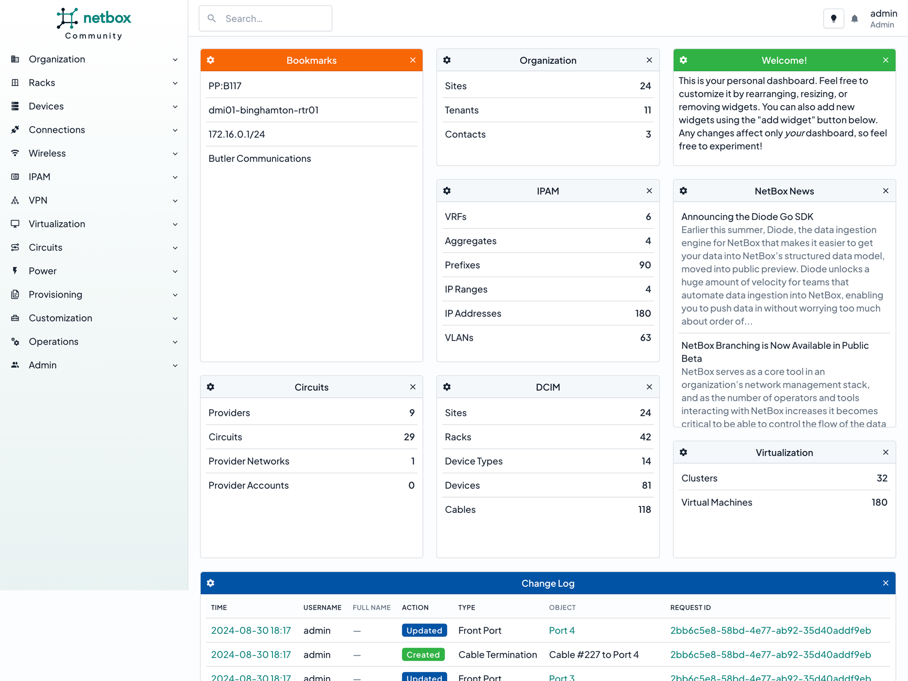

{style="height: 100px; margin-bottom: 3em; background: none;"}
{style="height: 100px; margin-bottom: 3em; background: none;"}

# The Premier Network Source of Truth

NetBox is the leading solution for modeling and documenting modern networks. It forms the core of the [NetBox Labs](https://netboxlabs.com/) platform, alongside [network discovery](https://netboxlabs.com/products/netbox-discovery/), [assurance](https://netboxlabs.com/products/netbox-assurance/), and [observability](https://netboxlabs.com/products/netbox-observability/). By combining the traditional disciplines of IP address management (IPAM) and datacenter infrastructure management (DCIM) with powerful APIs and extensions, NetBox provides the ideal "source of truth" to power network automation. Read on to discover why thousands of organizations worldwide put NetBox at the heart of their infrastructure.

NetBox is available in three editions:

* [**NetBox Community**](https://netboxlabs.com/community/) - The free, open source edition, which you deploy and manage yourself
* [**NetBox Cloud**](https://netboxlabs.com/netbox-cloud/) - A fully managed service hosted by NetBox Labs
* [**NetBox Enterprise**](https://netboxlabs.com/netbox-enterprise/) - A self-hosted deployment of the NetBox Labs platform

## :material-server-network: Built for Networks

Unlike general-purpose configuration management databases (CMDBs), NetBox has curated a data model which caters specifically to the needs of network engineers and operators. It delivers a wide assortment of object types carefully crafted to best serve the needs of infrastructure design and documentation. These cover all facets of network technology, from IP address management to cabling to overlays and more:

* Hierarchical regions, sites, and locations
* Racks, devices, and device components
* Device and module types for modular hardware
* Virtual chassis and virtual device contexts
* Cables and cable bundles
* Wireless LANs and point-to-point links
* Power distribution tracking
* Data center cooling infrastructure
* Physical and virtual circuits and providers
* Virtual machines and clusters
* IP prefixes, ranges, and addresses
* MAC addresses
* VRFs and route targets
* FHRP groups (VRRP, HSRP, etc.)
* AS numbers and ranges
* VLANs, scoped VLAN groups, and VLAN translation
* L2VPN overlays
* VPN tunnels and IKE/IPSec policies
* Application services
* Tenancy assignments
* Resource ownership
* Contact management

## :material-hammer-wrench: Customizable & Extensible

In addition to its expansive and robust data model, NetBox offers myriad mechanisms through which it can be customized and extended. Its powerful plugin architecture enables users to extend the application to meet their needs with minimal development effort.

* Custom fields
* Tags
* Custom links
* Custom validation & protection rules
* Export templates
* Configuration contexts & templates
* Custom scripts
* Event rules & webhooks
* Data synchronization from Git and S3
* Plugins
* REST & GraphQL APIs

## :material-lock-open: Always Open

Because the core NetBox application is open source and licensed under [Apache 2](https://www.apache.org/licenses/LICENSE-2.0.html), its entire code base is completely accessible to the end user, and there's never a risk of vendor lock-in. Additionally, NetBox development is an entirely public, community-driven process to which everyone can provide input.

!!! tip "NetBox Development"
    Interested in contributing to NetBox? Check out our [GitHub repository](https://github.com/netbox-community/netbox) to get started!

## :material-language-python: Powered by Python

NetBox is built on the enormously popular [Django](https://www.djangoproject.com/) framework for the Python programming language, already a favorite among network engineers. Users can leverage their existing skills coding Python tools to extend NetBox's already vast functionality via custom scripts and plugins.

## :material-flag: Getting Started

-   :material-cloud-outline:{ .lg .middle } __NetBox Cloud Free Tier__

    ---

    Skip the installation process and grab your own NetBox Cloud instance, preconfigured and ready to go in minutes. Completely free!

    :octicons-arrow-right-24: [Sign Up](https://signup.netboxlabs.com/)

-   :material-download:{ .lg .middle } __Install NetBox__

    ---

    Follow the installation guide to deploy NetBox Community on your own infrastructure.

    :octicons-arrow-right-24: [Installation Guide](./installation/index.md)

-   :material-docker:{ .lg .middle } __Docker Image__

    ---

    Use the community-maintained Docker image for a low-touch, containerized deployment.

    :octicons-arrow-right-24: [NetBox Docker](https://github.com/netbox-community/netbox-docker)

